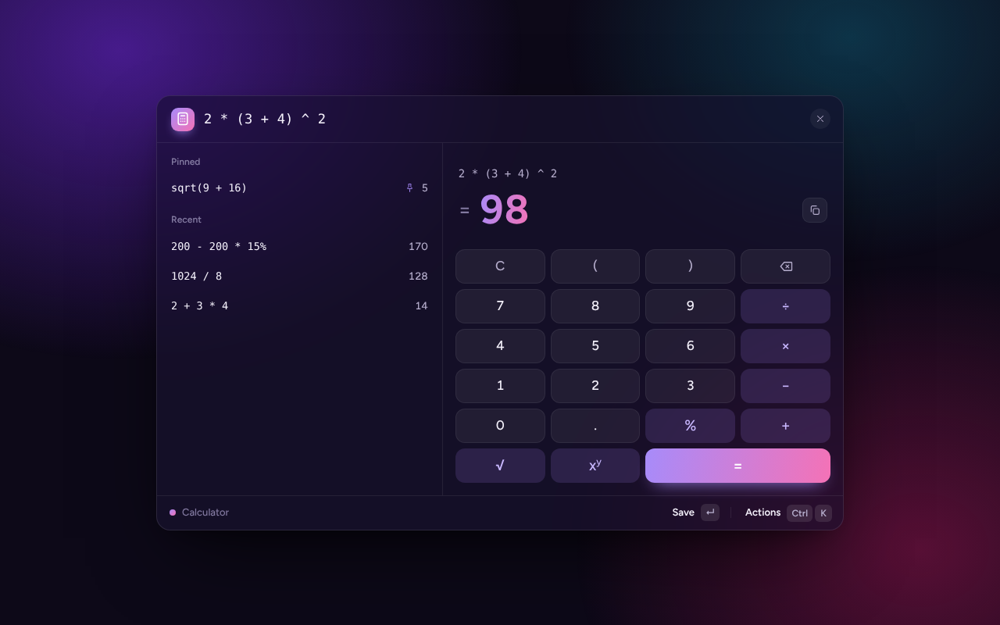
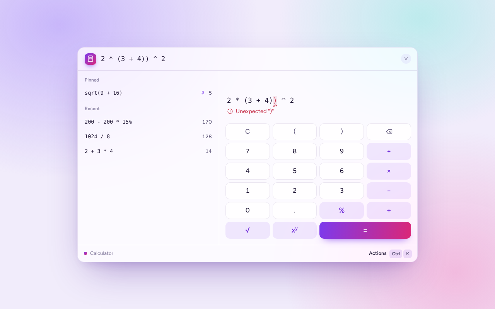
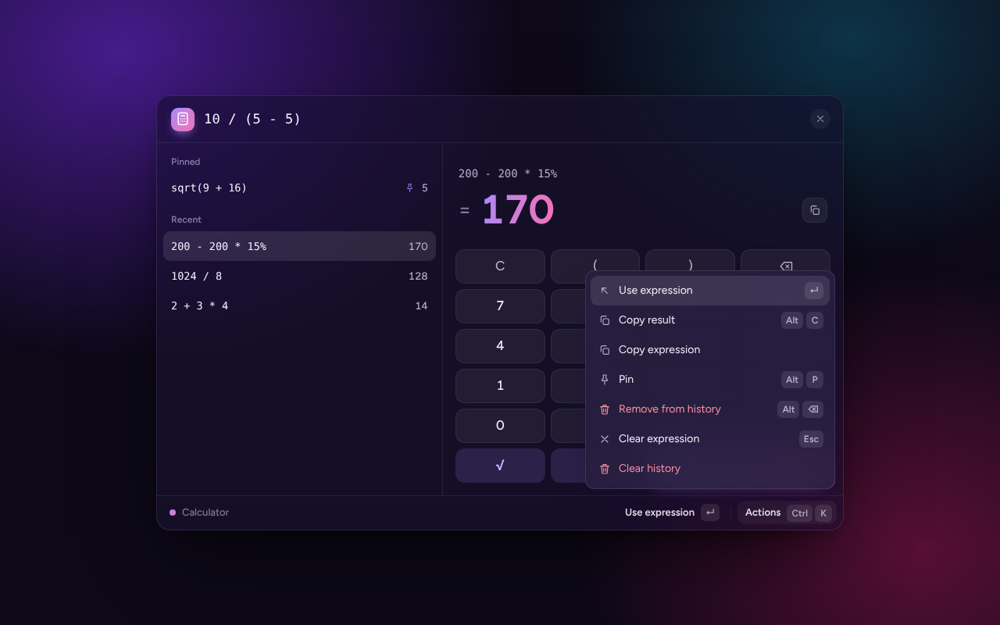
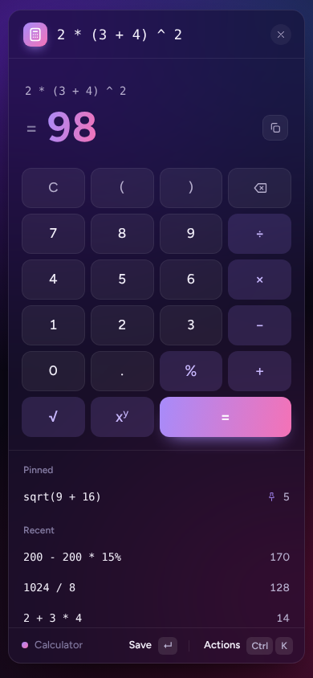

# Calculator

A full-stack calculator: a **Go** REST API that evaluates arithmetic, and a **React + TypeScript** frontend built around a command bar. You type a whole expression, such as `2 * (3 + 4) ^ 2`, and the result appears as you type.



| Syntax errors point at the exact character                                                             | Action panel                                                                               | Mobile                                                                            |
| ------------------------------------------------------------------------------------------------------ | ------------------------------------------------------------------------------------------ | --------------------------------------------------------------------------------- |
|  |  |  |

## Contents

- [Quick start](#quick-start)
- [Using the calculator](#using-the-calculator)
- [API](#api)
- [Tests and coverage](#tests-and-coverage)
- [Project structure](#project-structure)
- [Design decisions](#design-decisions)
- [Assumptions and limitations](#assumptions-and-limitations)
- [AI usage](#ai-usage)

## Quick start

### With Docker

The only requirement is Docker. One image contains the API and the web application.

```bash
docker compose up --build
```

Open <http://localhost:8080>.

Without Compose:

```bash
docker build -t calculator .
docker run --rm -p 8080:8080 calculator
```

### Without Docker

Requirements: **Go 1.24+** and **Node.js 22+**.

Start the backend, which listens on port 8080:

```bash
cd backend
go run ./cmd/server
```

In a second terminal, start the frontend:

```bash
cd frontend
npm install
npm run dev
```

Open <http://localhost:5173>. The Vite dev server forwards `/api` to the backend, so no further configuration is needed.

### Configuration

The backend reads its configuration from environment variables.

| Variable               | Default                 | Purpose                                                                                                               |
| ---------------------- | ----------------------- | --------------------------------------------------------------------------------------------------------------------- |
| `PORT`                 | `8080`                  | Port to listen on.                                                                                                    |
| `CORS_ALLOWED_ORIGINS` | `http://localhost:5173` | Comma-separated browser origins allowed to call the API. Empty disables CORS.                                         |
| `STATIC_DIR`           | unset                   | Directory with the compiled frontend. When set, the server also serves the web application. The Docker image sets it. |

## Using the calculator

The interface is a command bar: the expression is text, and everything can be done from the keyboard. An on-screen keypad is there for touch devices and for anyone who prefers clicking.

| Key                           | Action                                  |
| ----------------------------- | --------------------------------------- |
| _type_                        | The result updates as you type          |
| `Enter`                       | Save the calculation to the history     |
| `↑` `↓`                       | Browse the history                      |
| `Enter` on a history entry    | Bring that expression back into the bar |
| `Ctrl` `K` (`⌘` `K` on macOS) | Open the action panel                   |
| `Alt` `C`                     | Copy the result                         |
| `Alt` `P`                     | Pin or unpin the selected entry         |
| `Alt` `⌫`                     | Remove the selected entry               |
| `Esc`                         | Deselect, then clear the bar            |

The history is kept in the browser (`localStorage`), and pinned entries stay at the top. The theme follows the operating system (light or dark).

### Expression syntax

| Element          | Examples                        | Notes                                    |
| ---------------- | ------------------------------- | ---------------------------------------- |
| Numbers          | `42` `3.14` `.5` `1e3` `2.5E-4` |                                          |
| Add, subtract    | `2 + 3` `10 - 4 - 3`            | Left-associative: `10 - 4 - 3 = 3`       |
| Multiply, divide | `4 * 2.5` `10 / 4`              | Higher precedence than `+` and `-`       |
| Power            | `2 ^ 10`                        | Right-associative: `2 ^ 3 ^ 2 = 512`     |
| Unary sign       | `-5` `3 * -2`                   | Lower precedence than `^`: `-2 ^ 2 = -4` |
| Percent          | `50%` `200 - 200 * 15%`         | Postfix; `x%` means `x / 100`            |
| Square root      | `sqrt(16)` `sqrt(9 + 16)`       |                                          |
| Grouping         | `(2 + 3) * 4`                   | Up to 64 levels deep                     |

## API

Base URL: `http://localhost:8080`. Requests and responses are JSON. Ready-to-run requests for the VS Code REST Client extension are in [`backend/api.http`](backend/api.http).

| Method | Path                 | Purpose                                  |
| ------ | -------------------- | ---------------------------------------- |
| `POST` | `/api/v1/evaluate`   | Evaluate a full expression               |
| `POST` | `/api/v1/calculate`  | Perform a single operation               |
| `GET`  | `/api/v1/operations` | List the operations `calculate` supports |
| `GET`  | `/healthz`           | Liveness probe                           |

### Evaluate an expression

```bash
curl -X POST http://localhost:8080/api/v1/evaluate \
  -H 'Content-Type: application/json' \
  -d '{"expression": "2 * (3 + 4) ^ 2"}'
```

```json
{ "expression": "2 * (3 + 4) ^ 2", "result": 98 }
```

A malformed expression is a `400` that says where the problem is. `position` is the zero-based character offset.

```bash
curl -X POST http://localhost:8080/api/v1/evaluate \
  -H 'Content-Type: application/json' \
  -d '{"expression": "(2 + 3"}'
```

```json
{
  "error": {
    "code": "SYNTAX_ERROR",
    "message": "missing closing \")\"",
    "position": 6
  }
}
```

A well-formed expression that has no answer is a `422`.

```bash
curl -X POST http://localhost:8080/api/v1/evaluate \
  -H 'Content-Type: application/json' \
  -d '{"expression": "10 / (5 - 5)"}'
```

```json
{ "error": { "code": "DIVISION_BY_ZERO", "message": "cannot divide by zero" } }
```

### Perform a single operation

`operation` is one of `add`, `subtract`, `multiply`, `divide`, `power`, `percentage` (two operands, `a` and `b`) or `sqrt` (only `a`). `percentage` answers "what is `a`% of `b`?".

```bash
curl -X POST http://localhost:8080/api/v1/calculate \
  -H 'Content-Type: application/json' \
  -d '{"operation": "divide", "a": 10, "b": 4}'
```

```json
{ "operation": "divide", "result": 2.5 }
```

### List operations

```bash
curl http://localhost:8080/api/v1/operations
```

```json
{
  "operations": [
    { "name": "add", "operands": 2 },
    { "name": "divide", "operands": 2 },
    { "name": "multiply", "operands": 2 },
    { "name": "percentage", "operands": 2 },
    { "name": "power", "operands": 2 },
    { "name": "sqrt", "operands": 1 },
    { "name": "subtract", "operands": 2 }
  ]
}
```

### Errors

Every error has the same shape, `{ "error": { "code", "message" } }`, so clients branch on `code` and show `message`.

| Status | Code                     | When                                                                                    |
| ------ | ------------------------ | --------------------------------------------------------------------------------------- |
| 400    | `INVALID_REQUEST`        | Body is not valid JSON, has unknown fields, wrong types, or a required field is missing |
| 400    | `MISSING_OPERAND`        | `calculate` without `a`, or without `b` for a two-operand operation                     |
| 400    | `UNKNOWN_OPERATION`      | `calculate` with an operation that does not exist                                       |
| 400    | `SYNTAX_ERROR`           | `evaluate` with a malformed expression; includes `position`                             |
| 400    | `EXPRESSION_TOO_LONG`    | Expression longer than 256 characters                                                   |
| 404    | `NOT_FOUND`              | Unknown route                                                                           |
| 405    | `METHOD_NOT_ALLOWED`     | Wrong HTTP method; the `Allow` header names the right one                               |
| 413    | `PAYLOAD_TOO_LARGE`      | Body larger than 1 KiB                                                                  |
| 415    | `UNSUPPORTED_MEDIA_TYPE` | `Content-Type` is not `application/json`                                                |
| 422    | `DIVISION_BY_ZERO`       | Division by zero                                                                        |
| 422    | `NEGATIVE_SQRT`          | Square root of a negative number                                                        |
| 422    | `RESULT_OUT_OF_RANGE`    | Overflow, or an undefined result such as `(-8) ^ 0.5`                                   |
| 500    | `INTERNAL_ERROR`         | Unexpected failure; details go to the logs, never to the client                         |

## Tests and coverage

### Backend

```bash
cd backend
go test ./... -cover
```

An HTML report:

```bash
go test ./... -coverprofile=coverage.out
go tool cover -html=coverage.out -o coverage.html
```

| Package                       | Statement coverage |
| ----------------------------- | ------------------ |
| `internal/calculator`         | 100%               |
| `internal/expression`         | 100%               |
| `internal/api`                | 98.9%              |
| Total, including `cmd/server` | 91.7%              |

`cmd/server` (`main.go`) only wires configuration, the HTTP server and graceful shutdown; it has no unit tests, and that is what brings the total below the per-package figures.

The expression parser also has a fuzz test, which checks that no input can make it panic or return a non-finite number:

```bash
go test ./internal/expression -fuzz=FuzzEvaluate -fuzztime=30s
```

On Windows, `go test -race` needs a C compiler. The race detector runs in CI instead.

### Frontend

```bash
cd frontend
npm test            # run once
npm run coverage    # run with coverage; HTML report in frontend/coverage/
npm run lint
```

141 tests. Coverage: 96.9% of statements, 93.9% of branches, 99.1% of functions, 97.8% of lines.

The component tests drive the real UI with simulated typing, clicks and shortcuts against a fake `fetch`, so they cover the reducer, the hook and the components together.

### Continuous integration

[`.github/workflows/ci.yml`](.github/workflows/ci.yml) runs on every push and pull request: formatting, `go vet`, tests with the race detector, a short fuzzing session, frontend lint, tests and build, and finally a Docker build with a smoke test against the running container. Both coverage reports are uploaded as artifacts.

## Project structure

```
.
├── backend/
│   ├── cmd/server/main.go        entry point: configuration, server, graceful shutdown
│   ├── internal/
│   │   ├── calculator/           arithmetic and its typed errors; no HTTP
│   │   ├── expression/           lexer, parser and syntax tree for expressions
│   │   └── api/                  routes, validation, middleware, static files
│   └── api.http                  example requests
├── frontend/
│   └── src/
│       ├── api/                  typed client for the backend
│       ├── state/                pure reducer: all state transitions
│       ├── hooks/                connects the reducer to the API and to storage
│       ├── components/           the UI, one CSS Module per component
│       ├── lib/                  formatting, persistence, small helpers
│       └── styles/               design tokens and global styles
├── Dockerfile                    multi-stage build of the single image
├── docker-compose.yml
└── PROMPTS.md                    the prompts used while building this
```

## Design decisions

### Backend

- **Three packages, one responsibility each.** `calculator` knows arithmetic and nothing about HTTP. `expression` turns text into a tree of operations. `api` owns everything about transport. Each can be tested on its own, and the dependency direction is one-way: `api` → `expression` → `calculator`.
- **The expression evaluator reuses the calculator.** Every node of the syntax tree delegates to `calculator.Calculate`, so a rule such as "division by zero is an error" or "a result must be finite" is defined in exactly one place and behaves the same in both endpoints.
- **Recursive-descent parser.** Each precedence level of the grammar is one function. It reads like the grammar, it produces precise error positions, and it needed no dependencies. The grammar is documented at the top of `parser.go`.
- **Typed errors mapped to status codes in one function.** The domain returns sentinel errors; `mapCalculatorError` translates them. `400` means the request is malformed, `422` means the request is fine but the math has no answer.
- **Strict input handling.** The body is limited to 1 KiB, unknown JSON fields are rejected, and operands are pointers so that a missing operand is distinguishable from an explicit `0`. Expressions are limited in length and nesting depth so that no input can exhaust the stack.
- **Standard library only.** `net/http`, `encoding/json` and `log/slog` cover the needs of this service; there are no third-party modules to audit or keep updated.
- **Production basics.** Structured JSON logs, panic recovery that never leaks internals, server timeouts, and graceful shutdown on `SIGTERM`.

### Frontend

- **The frontend does no arithmetic.** It sends the expression and renders the answer. The backend is the single source of truth, so there is no second implementation of the rules to keep in sync. The only client-side check is the length limit.
- **A command bar instead of a button grid.** Since the backend evaluates whole expressions, the natural input is text. The keypad is still there, and it inserts at the caret exactly like typing.
- **A pure reducer holds every state transition.** It does no I/O; ids and timestamps arrive inside the actions. That makes the logic testable without rendering anything. It also removed a race: saving with `Enter` before the answer arrives is recorded as a pending request in the state, rather than decided from a value captured during an earlier render.
- **Stale answers can never win.** Typing cancels the pending timer and aborts the request in flight, and the reducer additionally discards any answer for an expression that is no longer in the input.
- **Errors are shown where they are.** The backend's `position` is used to underline the offending character. An expression that is merely unfinished, such as `2 +`, is shown as a calm hint, since that is normal while typing.
- **Accessibility.** The input is a labelled combobox tied to the history list, results are announced through a live region, every control has an accessible name and a visible focus ring, and animations respect `prefers-reduced-motion`.
- **CSS Modules with design tokens, no UI library.** All colours, radii and shadows are variables in `tokens.css`, defined once per colour scheme. The font is self-hosted, so the application makes no third-party requests.

### Deployment

- **One image.** The Go server serves the compiled frontend, so there is one process, one port and no CORS in production. The final image is distroless and runs as a non-root user.
- **Caching.** Files under `/assets/` have a content hash in their name and are cached indefinitely; `index.html` is always revalidated.

## Assumptions and limitations

- **Numbers are IEEE 754 doubles.** Results are exact to about 15 significant digits. The UI rounds to 15 digits for display, so `0.1 + 0.2` shows as `0.3`. This is not suitable for arbitrary-precision or monetary arithmetic.
- **`%` means "divided by 100".** `10% * 200` is `20`, and `200 + 10%` is `200.1`, not `220`. Pocket calculators differ on this; the mathematical reading was chosen because it is unambiguous.
- **No implicit multiplication.** `2(3)` is a syntax error; write `2 * (3)`.
- **`sqrt` is the only function**, and names are case-sensitive.
- **The history is local to the browser.** There are no accounts and nothing is stored on the server.
- **A failed request is not retried automatically.** If the backend was unreachable, editing the expression triggers a new attempt.
- **No authentication or rate limiting.** They would belong in a gateway in front of this service.
- **Browser testing.** The interface was exercised in Chrome. Other browsers were not tested by hand.

## AI usage

This project was built with the help of an AI assistant. The prompts are in [`PROMPTS.md`](PROMPTS.md).
